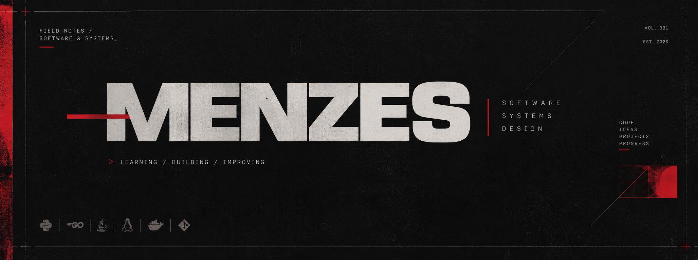

  

  

    <em>
      Aprendendo como sistemas funcionam.
      Construindo para entender.
    </em>
  

---

## 01 / SOBRE

Sou estudante de **Engenharia de Software**, interessado em entender como sistemas são projetados, construídos e mantidos.

Meu foco de estudo passa por **desenvolvimento backend, arquitetura de software e desenvolvimento web**. Tenho explorado Python, Go e Java por meio de exercícios e projetos práticos, buscando fortalecer meus fundamentos e escrever código cada vez mais claro, organizado e sustentável.

Também gosto de investigar ferramentas, sistemas e ideias que conectam tecnologia, design e cultura digital.

## 02 / CURRENTLY EXPLORING

| ÁREA | INTERESSE |
|:---|:---|
| `BACKEND` | APIs, regras de negócio e integração entre serviços |
| `ARCHITECTURE` | organização de código, padrões de projeto e manutenibilidade |
| `SYSTEMS` | Linux, containers e ferramentas de desenvolvimento |
| `FOUNDATIONS` | lógica, estruturas de dados e resolução de problemas |

## 03 / TOOLBOX

**Linguagens**  

**Ambiente & ferramentas**  

## 04 / SELECTED WORK

Gosto de projetos que me permitem sair da teoria, experimentar decisões técnicas e documentar o que aprendi.

<!-- Adicione aqui projetos que representem bem seu trabalho. Exemplo:

### [Nome do projeto](https://github.com/SEU_USUARIO/SEU_REPOSITORIO)
Uma descrição curta do problema, da solução e do que você aprendeu.

`Python` `FastAPI` `PostgreSQL`

-->

_Projetos em destaque serão adicionados aqui à medida que forem documentados._

## 05 / CONTACT

  <a href="https://www.linkedin.com/in/glhrm-mnzs?utm_source=share_via&utm_content=profile&utm_medium=member_android">LINKEDIN</a>
  &nbsp; / &nbsp;
  <a href="mailto:SEU_EMAIL">EMAIL</a>

---

  MADE WITH CURIOSITY &nbsp; · &nbsp; REVISED AS I LEARN

